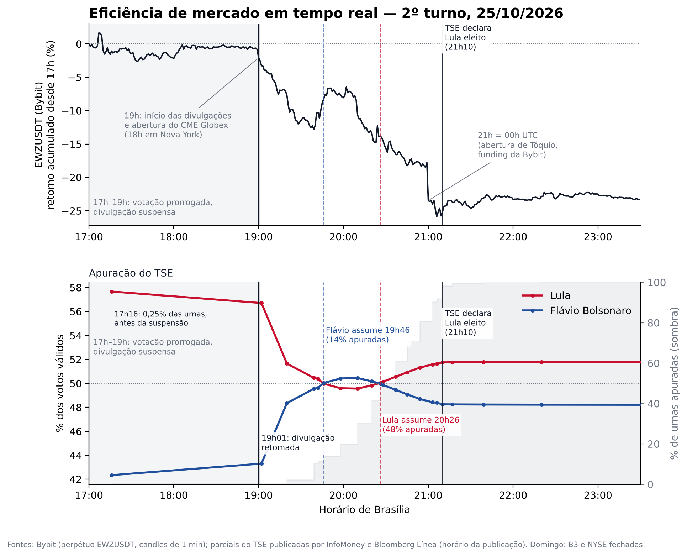

# Market efficiency in real time — Brazil's 2026 presidential runoff (Oct 25, 2026)

*[Versão em português](README.md)*

Minute-by-minute comparison between the price of the **EWZUSDT** perpetual contract (Bybit; it tracks the iShares MSCI Brazil ETF and trades 24/7) and the **official vote count** of the presidential runoff released by Brazil's electoral court (TSE).

With the Brazilian (B3) and US (NYSE) exchanges closed on a Sunday, this contract was one of the few liquid "Brazil" prices trading while the votes were being counted.



## Files

| File | Content |
|---|---|
| `eleicao_vs_ewz.py` | Script that downloads the Bybit data and draws the chart |
| `ewz_bybit_1min.csv` | 1-minute EWZUSDT candles, 4:30–11:30 pm (Brasília time, UTC−3) |
| `apuracao_manual.csv` | Partial vote-count results (time, % of ballot boxes counted, % of valid votes for each candidate, source) |
| `eleicao_vs_ewz.png` | Final chart |

## How to run

```bash
pip install requests pandas matplotlib
python eleicao_vs_ewz.py            # downloads prices from Bybit's public API (no key needed)
python eleicao_vs_ewz.py --offline  # uses the included ewz_bybit_1min.csv
```

## Sources

- **Prices:** Bybit public API v5 (`/v5/market/kline`), 1-minute candles.
- **Vote count:** official TSE partial results, collected from the live blogs of InfoMoney and Bloomberg Línea. The TSE does not publish a minute-by-minute history of its releases (the public results file is overwritten at every update).

## Notes

- EWZUSDT is a leveraged, USDT-settled derivative with much lower liquidity than EWZ itself. It shows where the market wanted to go, not an equilibrium price for Brazilian equities.
- Vote-count timestamps are the times the news outlets published each update, usually 1–2 minutes after the TSE release.
- The earliest partial results (5:16 pm and 7:02 pm) cover less than 0.3% of ballot boxes and are not representative of the outcome; they are shown only to illustrate the sequence of releases.
- Voting was extended until 7 pm by a Supreme Court (STF) decision; result releases were essentially paused between 5 pm and 7 pm.
- The drop starting at 7 pm coincides with the resumption of releases (7:01 pm) and with the Sunday open of CME Globex (6 pm in New York). I found no record of an exit poll being released at that time.
- The −7% step at 9 pm coincides with 00:00 UTC (Tokyo open and a Bybit funding settlement). This is a hypothesis, not a verified explanation.
- The TSE officially declared the winner at 9:10 pm.
- This is a data-communication exercise, not an academic paper, and implies no political position.

Author: Ricardo Buscariolli
