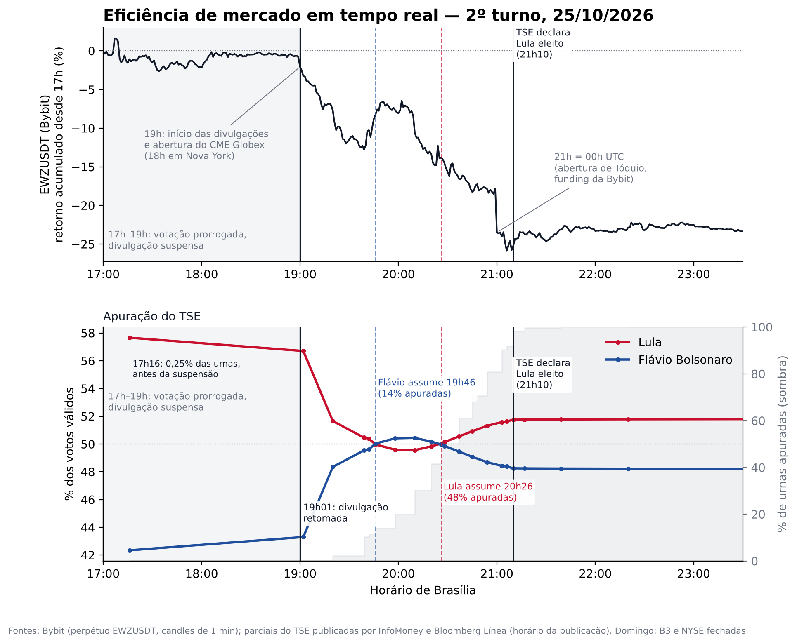

# Eficiência de mercado em tempo real — 2º turno das eleições brasileiras (25/10/2026)

*[English version](README.en.md)*

Cruzamento, minuto a minuto, entre o preço do perpétuo **EWZUSDT** (Bybit, que acompanha o ETF iShares MSCI Brazil e negocia 24/7) e a **apuração do 2º turno presidencial** divulgada pelo TSE.



## Arquivos

| Arquivo | Conteúdo |
|---|---|
| `eleicao_vs_ewz.py` | Script que baixa os dados da Bybit e gera o gráfico |
| `ewz_bybit_1min.csv` | Candles de 1 minuto do EWZUSDT, 16h30–23h30 (horário de Brasília) |
| `apuracao_manual.csv` | Parciais da apuração (horário, % de urnas apuradas, % de votos válidos de cada candidato, fonte) |
| `eleicao_vs_ewz.png` | Gráfico final |

## Como rodar

```bash
pip install requests pandas matplotlib
python eleicao_vs_ewz.py            # baixa os preços da API pública da Bybit (sem chave)
python eleicao_vs_ewz.py --offline  # usa o ewz_bybit_1min.csv já incluído
```

## Fontes

- **Preços:** API pública da Bybit v5 (`/v5/market/kline`), candles de 1 minuto.
- **Apuração:** parciais oficiais do TSE, coletadas dos blogs ao vivo da InfoMoney e da Bloomberg Línea. O TSE não disponibiliza o histórico minuto a minuto da divulgação (o arquivo público é sobrescrito a cada atualização).

## Observações

- O EWZUSDT é um derivativo alavancado, liquidado em USDT, com liquidez bem menor que a do EWZ. Mostra para onde o mercado quis ir, não um preço de equilíbrio do Ibovespa.
- Os horários da apuração são os da publicação das notícias, normalmente 1–2 minutos depois do dado do TSE.
- As primeiras parciais (17h16 e 19h02) correspondem a menos de 0,3% das urnas e não são representativas do resultado; aparecem no gráfico apenas para mostrar a sequência da divulgação.
- A votação foi prorrogada até 19h por decisão do STF; a divulgação de resultados ficou praticamente parada entre 17h e 19h.
- A queda a partir das 19h coincide com a retomada da divulgação (19h01) e com a abertura do CME Globex (18h em Nova York). Não encontrei registro de boca de urna divulgada nesse horário.
- O degrau de −7% às 21h coincide com 00h UTC (abertura de Tóquio e liquidação de *funding* na Bybit). É uma hipótese, não uma explicação verificada.
- Exercício de divulgação, não um trabalho acadêmico. Não há qualquer posição política implícita.

Autor: Ricardo Buscariolli
